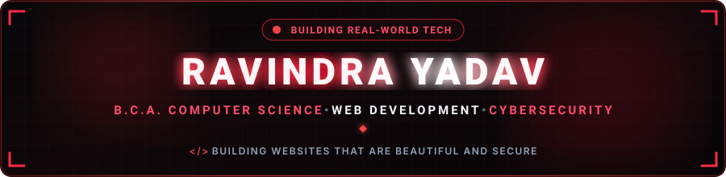

  

  

  
  &nbsp;
  
  &nbsp;
  

  

---

<h2 align="center">🔴 About Me</h2>

  

  

  Hi! I'm <b>Ravindra Yadav</b>, a BCA student at <b>Prof. Rajendra Singh (Rajju Bhaiya) University (PRSU), Prayagraj</b>. 
  I am passionate about Web Development and Cybersecurity—two fields that I believe will shape the future of the digital world.

  
  &nbsp;
  
  &nbsp;
  

  💬 <b>Core Focus Areas:</b> C Programming, Digital Electronics, AI & Productivity Tools, Mathematics for Computing. 
  ⚡ <b>Goal:</b> <i>"To become a skilled Web Developer with a strong understanding of Cybersecurity so I can build websites that are not just beautiful, but also secure."</i>

<table width="100%" border="0" align="center">
<tr>
<td width="50%" align="center" style="padding: 14px;">
  <h4>🔭 Current Foundation</h4>
  
<b>C Programming &amp; Logic</b> Digital Electronics &amp; Math

</td>
<td width="50%" align="center" style="padding: 14px;">
  <h4>🌱 Active Deep Dives</h4>
  
<b>Web Dev &amp; Cybersecurity</b> AI &amp; Productivity Tools

</td>
</tr>
<tr>
<td width="50%" align="center" style="padding: 14px;">
  <h4>🎓 Education</h4>
  
<b>PRSU Prayagraj</b> Bachelor of Computer Applications (BCA)

</td>
<td width="50%" align="center" style="padding: 14px;">
  <h4>🤝 Open To</h4>
  
<b>Internships &amp; Projects</b> Collaborative Learning &amp; Networking

</td>
</tr>
</table>

---
<h2 align="center">🛠️ Tech Stack & Skills</h2>

<b>Core Programming & Foundations</b>

  

<b>Tools & Environment</b>

  

<b>AI & Content Tools</b>

  
  &nbsp;
  

---

<h2 align="center">📬 Let's Connect</h2>

<i>Whether you want to discuss web development, cybersecurity concepts, or explore opportunities — my inbox is always open!</i>

<table border="0" align="center">
<tr>
<td align="center" width="220" style="padding: 16px;">
  <a href="https://www.linkedin.com/in/ravindrayadav-in" target="_blank">
    
      
    
  </a>
   
  <b>Professional Network</b>
</td>
<td align="center" width="220" style="padding: 16px;">
  <a href="mailto:ravindrayd329@gmail.com">
    
      
    
  </a>
   
  <b>Direct Collaboration</b>
</td>
</tr>
</table>
