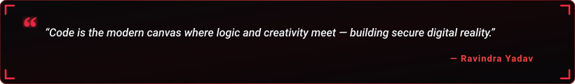

  

  

  
  &nbsp;
  
  &nbsp;
  

  

---

<h2 align="center">🔴 About Me</h2>

  

  

  Hi! I'm <b>Ravindra Yadav</b>, a <b>B.C.A. (Computer Science)</b> student at <b>Prof. Rajendra Singh (Rajju Bhaiya) University (PRSU)</b>, Prayagraj. 
  I am deeply passionate about <b>Web Development</b> and <b>Cybersecurity</b> &mdash; two foundational domains that shape the future of our digital ecosystem. 
  My mission is to master modern web technologies while gaining strong cybersecurity acumen to architect websites that are not just beautiful, but resilient and secure.

  
  &nbsp;
  
  &nbsp;
  
  &nbsp;
  

  💬 <b>Core Foundation:</b> C Programming &bull; HTML &amp; CSS &bull; Digital Electronics &bull; AI Tools &bull; Computing Mathematics 
  ⚡ <b>Philosophy:</b> <i>"Building websites that are not just beautiful, but also secure."</i>

<table width="100%" border="0" align="center">
<tr>
<td width="50%" align="center" style="padding: 14px;">
  <h4>💻 Web &amp; Security</h4>
  
<b>Web Development &amp; Cybersecurity</b> Building secure &amp; aesthetic digital experiences

</td>
<td width="50%" align="center" style="padding: 14px;">
  <h4>🌱 Foundation &amp; Logic</h4>
  
<b>C Programming &amp; Logic</b> Algorithms, Digital Electronics &amp; Math

</td>
</tr>
<tr>
<td width="50%" align="center" style="padding: 14px;">
  <h4>🎨 Creative Design</h4>
  
<b>Visual Presentations &amp; Storytelling</b> Eye for clean layout design &amp; structured visuals

</td>
<td width="50%" align="center" style="padding: 14px;">
  <h4>🤝 Open to Opportunities</h4>
  
<b>Internships &amp; Collaborations</b> Learning from mentors &amp; connecting with peers

</td>
</tr>
</table>

---

<h2 align="center">🛠️ Tech Stack &amp; Skills</h2>

<b>Programming Language</b>

  

<b>Frontend Development</b>

  

<b>Tools &amp; Environments</b>

  

<b>Domains &amp; Academic Foundations</b>

  
  &nbsp;
  
  &nbsp;
  
  &nbsp;
  
  &nbsp;
  

---

<h2 align="center">📊 GitHub Analytics &amp; Activity</h2>

  
  &nbsp;&nbsp;
  

  

  

---

<h2 align="center">⚡ Contribution Journey</h2>

  

---

<h2 align="center">📬 Let's Connect &amp; Collaborate</h2>

<i>Whether you want to discuss web development, explore collaborative projects, or just say hello — my inbox is always open!</i>

<table border="0" align="center">
<tr>
<td align="center" width="220" style="padding: 16px;">
  <a href="https://www.linkedin.com/in/ravindrayadav-in/" target="_blank">
    
      
    
  </a>
   
  <b>Professional Network</b>
</td>
<td align="center" width="220" style="padding: 16px;">
  <a href="mailto:ravindrayd329@gmail.com">
    
      
    
  </a>
   
  <b>Direct Inquiries</b>
</td>
<td align="center" width="220" style="padding: 16px;">
  <a href="https://github.com/ravindra-io" target="_blank">
    
      
    
  </a>
   
  <b>Repositories &amp; Code</b>
</td>
</tr>
</table>

  

